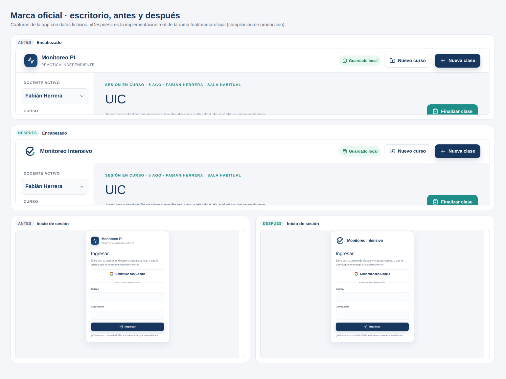
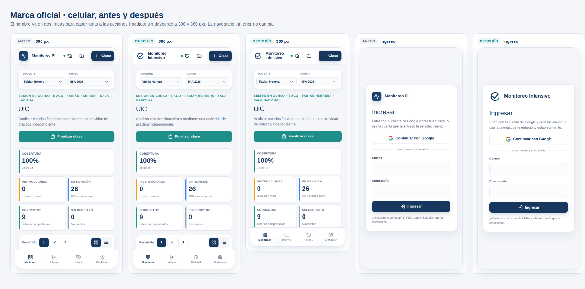

# Verificación de la marca oficial (ADR 0005)

Usa **solo datos ficticios**. En local: `npm run build && npm run start`.

## Pruebas automáticas

```bash
npm run check   # tipos, lint, pruebas y build
```

`src/config/brand.test.ts` comprueba el nombre oficial, que los SVG de `public/brand` usen la
misma geometría que la app, que no tengan contenido activo y que el manifest apunte a íconos
existentes.

## Revisión manual

| # | Dónde | Resultado esperado |
|---|---|---|
| 1 | Pestaña del navegador, clara y oscura | Recuadro marino con el símbolo blanco y el título «Monitoreo Intensivo» |
| 2 | Encabezado en escritorio | Isotipo libre de 36 px y «Monitoreo Intensivo» en una línea; sin subtítulo |
| 3 | Encabezado en celular (390 y 360 px) | Isotipo de 32 px y el nombre en dos líneas; las acciones no se desplazan ni se cortan |
| 4 | Pantalla de carga e inicio de sesión | Isotipo libre; en el ingreso, con el nombre al lado |
| 5 | Agregar a la pantalla de inicio (Android o iPhone) | Ícono marino; debajo, «Monitoreo» |
| 6 | Informe → Exportar PDF | Título «Monitoreo Intensivo · Informe de sesión» |
| 7 | Configuración → Restaurar respaldo con un archivo que no es respaldo | «El archivo no parece un respaldo de Monitoreo Intensivo.» |
| 8 | Restaurar un respaldo descargado antes de este cambio | Se restaura igual: el formato del respaldo no cambió |

## Antes y después




